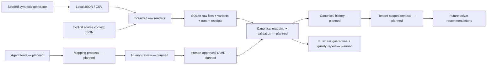

# Architecture

Implemented: local Python package, environment configuration, JSON logging, synthetic generator, bounded JSON/CSV readers, trusted source context and transactional SQLite raw store. Validation, agents, operational context and solver remain planned.

Raw storage already flags missing identity and conflicting payloads. This is not canonical business validation. Content variants retain first provenance; every replay appends receipts. An atomic batch transaction protects files, history and receipts. See INGESTION.md for exact identity, counter and rollback scope.

No distributed services or runtime dependencies needed. A simple Python workflow will coordinate future mapping tools. Reconsider orchestration frameworks only for demonstrated branching/resume needs; an optional provider interface may isolate future LLM suggestions.

The future read-only `get_equipment_context(hospital_id, equipment_id)` interface will distinguish observations, freshness/provenance, derived availability, maintenance, reservations, rules and suggestions. It is not implemented and RFID alone will not prove availability.
