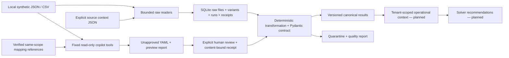

# Architecture — implemented through Phase 04 baseline

The copilot uses a fixed Python sequence for schema inspection, contract retrieval, approved reference loading, alias suggestions, structural checks, in-memory preview and quality metrics. Tool requests/responses are typed. Planning order is fixed; source data cannot choose tool names or paths. Artifact persistence is separate and cannot approve, change accepted mappings or write canonical data. It creates a new output directory and completion manifest; interrupted writes may leave uncompleted artifacts. See COPILOT.md.

Raw/canonical persistence remains the accepted Phase 02/03 implementation. Exact original bytes and first provenance are immutable. New canonical versions retain old interpretations; approval must match the new exact bytes. Preview has no knowledge of prior database conflicts and uses a clearly labelled simulated ingestion clock.

Optional provider is only a protocol for additional unconfirmed field candidates; no LLM/network client is implemented. Provider errors retain the deterministic baseline. A small local app needs no orchestration framework. Revisit LangGraph only for demonstrated branching/resume needs, without moving validation or authorization into a model.

The accepted Hospital A/B mappings and receipts remain unchanged. Generated drafts do not inherit approval. SQLite and local receipts are not authentication or production authorization. No equipment state, operational availability inference, reservations or optimization exists yet.
