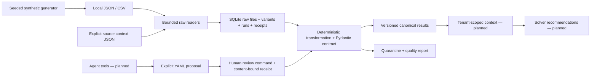

# Architecture — implemented through Phase 03

Single local Python application and SQLite. Raw data remains immutable; additive validation tables connect each result to raw_id, mapping hash, version and approval evidence. Each validation transaction commits mapping snapshot, new results, report and result links together. Replays append audit without duplicate interpretations; new approved mapping versions preserve prior history. Original bytes remain available even when business validation fails.

Canonical hospital/source must match trusted raw metadata. Rooms/types require explicit aliases; timestamps require timezone. Unknowns quarantine instead of guesses. CLI approval records local human attestation only; there is no authentication or signed approval. The user explicitly accepted the Hospital A/B YAMLs on 2026-11-18; local content-bound receipts now record that approval. Future proposals still require explicit review. See VALIDATION.md and ADR 0004.

No LLM, agent orchestration, vector database, operational state or optimization. Future tools will inspect schemas and propose mappings without bypassing this deterministic layer. Reconsider orchestration frameworks only when demonstrated branching/resume needs justify them.

Future get_equipment_context(hospital_id, equipment_id) will distinguish observations, freshness/provenance, derived availability, maintenance, reservations, rules and suggestions. No availability is inferred from RFID alone.
